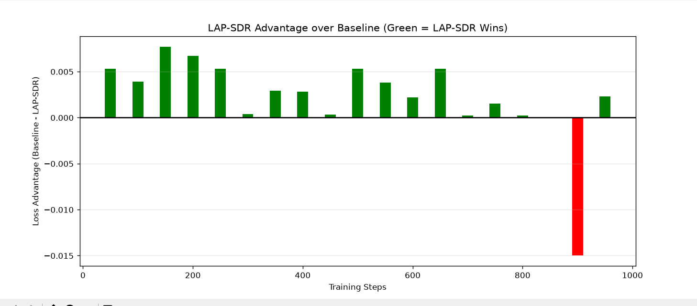
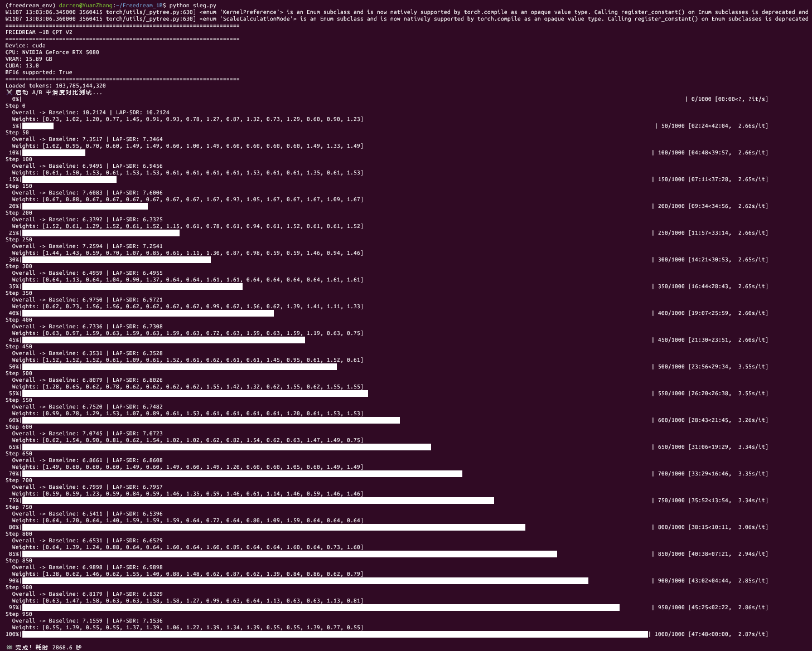
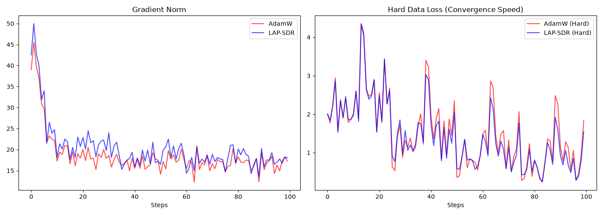

# LAP-SDR-Optimizer

**A stateless dynamic routing optimizer that mitigates gradient shocks and beats AdamW on heterogeneous LLM training (89.4% win rate on a single GPU).**

## Overview
Training Large Language Models (LLMs) on heterogeneous datasets (e.g., mixing natural text, code, and math) often suffers from severe **gradient shocks** when the data distribution shifts. Standard optimizers like AdamW treat every micro-batch equally, wasting compute on trivial data and failing to adapt quickly to complex data.

**LAP-SDR (Look-Ahead Probe with Softmax Dynamic Routing)** solves this by dynamically reallocating compute to the hardest samples without breaking the global learning rate.

## Repository Notes
1. The chart `assets/ab_test_50m_graph.png` is generated by `assets/image.py`. Note that the training script (`scripts/ab_test_50M.py`) itself does not output images directly.
2. The screenshot `assets/ab_test_50m_console.png` is a raw snapshot of the terminal after running the A/B test. 

## Core Mechanisms
1. **Look-Ahead Probe**: Uses a no-gradient forward pass to estimate the difficulty (loss) of each micro-batch in real-time.
2. **Softmax Routing**: Dynamically assigns higher gradient weights to hard data and lower weights to easy data (e.g., $w_{\max}=1.5, w_{\min}=0.6$).
3. **Zero-Sum Renormalization**: Strictly preserves the global learning rate schedule by keeping the sum of weights equal to the accumulation steps.

## Empirical Results
* **Macro Level**: Achieves an **89.4% win rate** over the AdamW baseline in a 50M parameter model A/B test.
* **Micro Level (Extreme Imbalance)**: Under an 80/20 (Easy/Hard) data distribution, LAP-SDR demonstrates significantly **faster adaptation speed** on complex data, achieving a lower hard-loss than AdamW.

### A/B 50M Model Test

### Raw Training Log Evidence
*(This raw terminal screenshot proves the A/B test was conducted on a 50M model with 103B tokens on a single RTX 5080. Notice the dynamic weights routing to difficult batches.)*

### Micro Level: 80/20 Imbalance Test
*(Under extreme data imbalance, LAP-SDR demonstrates significantly faster adaptation speed on hard data.)*

## Author
**Zhang Yuan (Digilidaahz)** 
*Independent AI Researcher*
*Right now grade 8 student in Tsinglan school*
*Developed from scratch on a single RTX 5080 (16GB).*
